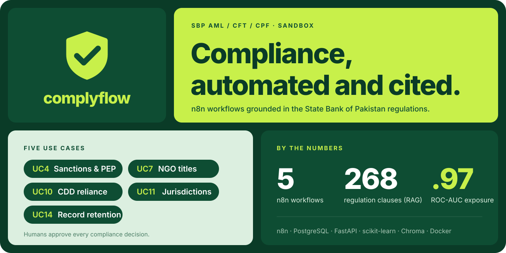
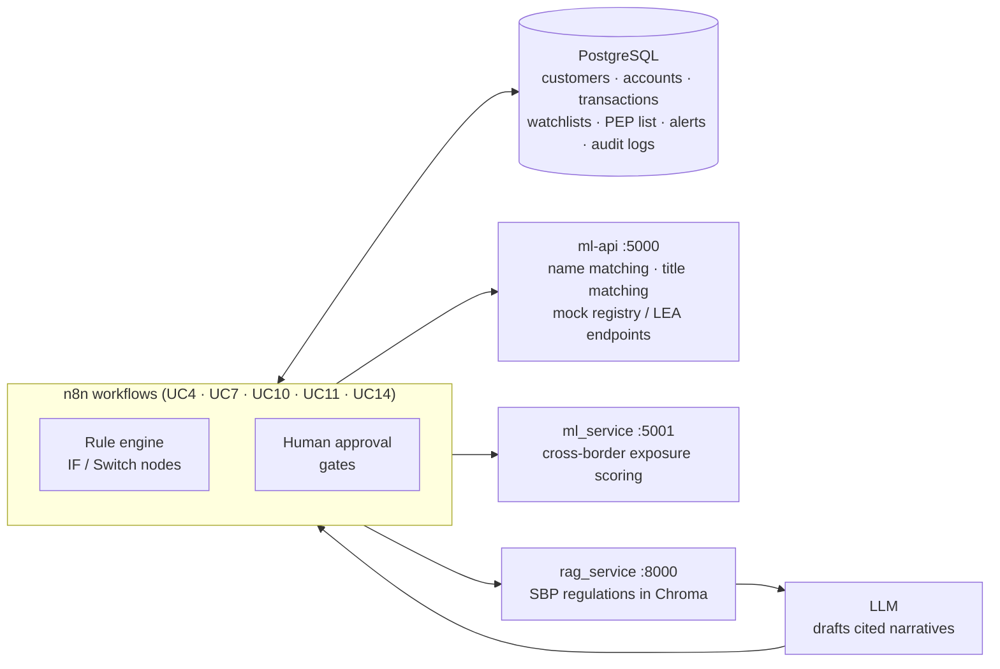

<p align="center">
  
</p>

<p align="center">
  
  
  
  
  
  
</p>

# Complyflow

**SBP AML/CFT compliance automation**

A sandbox project that automates five use cases from the **State Bank of Pakistan (SBP) AML/CFT/CPF Regulations** with n8n workflows, a PostgreSQL system of record, small calibrated ML models, and a retrieval (RAG) layer over the regulation text.

I built it while learning how banks handle anti-money-laundering compliance, which is still largely manual work. All data is **synthetic**.

> **Disclaimer:** This is an independent learning project. It is not affiliated with, endorsed by, or used by the State Bank of Pakistan or any bank, and it is not legal or compliance advice.

---

## Use cases

| # | Workflow | What it automates | Key SBP regulations |
|---|----------|-------------------|---------------------|
| **UC4** | Targeted Financial Sanctions (TFS) screening & freeze | Screens customers and counterparties against DP/PP watchlists and PEP lists, freezes confirmed matches, drafts FMU/SBP reports and Form-B notices | Reg 4 §3, §7(a)–(d), §8, §10 |
| **UC7** | NGO/NPO donation-title integrity monitor | Checks that NGO accounts operate under their registered title (semantic matching, not exact strings) and screens governing-body members | Reg 6 §1–5 |
| **UC10** | Third-party CDD reliance oversight | Tracks whether third parties the bank relies on for CDD are still regulated and active, and checks their jurisdiction risk | Reg 3 §2–7 |
| **UC11** | High-risk jurisdiction counter-measures | Scores direct and indirect cross-border exposure, applies tiered EDD, limits or rejections, and re-screens customers when a country's risk status changes | Reg 14 §1, Reg 9 §2, Reg 2 §16(b) |
| **UC14** | Record-keeping, retention & litigation hold | Enforces 10-year retention, blocks deletion under litigation holds, and builds transaction reconstruction bundles for law enforcement requests | Reg 8 §2–6 |

Full node-by-node designs (queries, rule engine, human approval, error handling, test data) are in [`n8n_aml_workflows_uc4_7_10_11_14.md`](n8n_aml_workflows_uc4_7_10_11_14.md), with per-workflow write-ups in [`technical_docs/`](technical_docs/).

## Design principle: deterministic first

The regulations state some rules as exact figures and leave others to judgment. The project treats them differently:

- **Explicit rules stay hard-coded** in n8n IF/Switch nodes, exactly as written: 10-year retention, 48-hour freeze reporting to SBP, dormancy notice timing, freeze-without-delay on a confirmed match, and mandatory approval gates.
- **Judgment calls use calibrated ML.** Where a regulation says "properly analyze any similarity" without giving a number, a trained model provides the threshold. The threshold is derived from a precision-recall curve on held-out data instead of being guessed.
- **Every AI-drafted document is grounded.** Before an LLM drafts an STR narrative or notice, the workflow retrieves the relevant regulation clause, and the draft must cite it.
- **Humans make the final call.** AML analysts, compliance officers and legal officers approve grey-zone matches, unfreezing, restrictions and litigation-hold releases.

## Architecture



## Models

| Model | Used in | Approach | Result (synthetic test set) |
|-------|---------|----------|-----------------------------|
| Name / entity matcher | UC4, UC7 | Logistic regression on fuzzy-match, phonetic (Soundex) and ID-match features | Thresholds from precision-recall curve: 0.73 high confidence, 0.63 grey zone |
| NGO title matcher | UC7 | Logistic regression on token-overlap and TF-IDF similarity | Match threshold 0.55 from precision-recall curve |
| Cross-border exposure classifier | UC11 | Gradient boosting on 6,000 synthetic corridor records | ROC-AUC 0.969, precision 0.95, recall 0.85 at calibrated cutoff |

See [`services/ml_service/model_card.md`](services/ml_service/model_card.md) for the calibration method.

The RAG service splits the SBP AML/CFT/CPF Regulations PDF into **268 clause-level chunks** and stores them in Chroma.

## Repository layout

```
.
├── docker-compose.yml            # PostgreSQL + n8n
├── schema.sql / test_data.sql    # shared synthetic schema and seed data
├── ml-api/                       # FastAPI: name/title matching, vector query, mock registry & LEA
├── services/
│   ├── ml_service/               # FastAPI: cross-border exposure classifier (UC11)
│   └── rag_service/              # FastAPI: SBP regulation retrieval over Chroma
├── uc4_workflow.json             # n8n workflow exports, one per use case
├── UC7 - NGO_NPO_...json
├── ThirdParty_CDD_Reliance_Oversight.json   # UC10
├── UC11_HighRisk_Jurisdiction_workflow.json
├── USE CASE 14 — ...json
├── technical_docs/               # per-use-case technical documentation
└── n8n_aml_workflows_uc4_7_10_11_14.md      # full blueprint
```

## Running it locally

**1. Start PostgreSQL and n8n**

```bash
docker compose up -d
psql -h localhost -U sbp_user -d sbp_sandbox -f schema.sql
psql -h localhost -U sbp_user -d sbp_sandbox -f test_data.sql
```

n8n reads its settings from a `.env` file (not committed).

**2. Start the ML and RAG services**

```bash
# name/title matching API (port 5000)
docker build -t sbp-ml-api ml-api && docker run -p 5000:5000 sbp-ml-api

# exposure classifier (port 5001) and regulation RAG (port 8000)
cd services && python -m venv venv && source venv/bin/activate
pip install -r requirements.txt
(cd ml_service && python train_exposure_model.py && uvicorn ml_service:app --port 5001) &
(cd rag_service && python load_regulations.py && uvicorn rag_service:app --port 8000) &
```

**3. Import the workflows**

In n8n (http://localhost:5678), import the workflow `.json` files. Add a Groq (or other LLM) credential for the AI nodes. Slack and email credentials are optional.

If n8n runs in Docker, point HTTP nodes at `host.docker.internal` instead of `localhost`. More detail is in [`services/README.md`](services/README.md).

## Author

**Kinza Afzal** · BS Computer Science, FAST NUCES Karachi
[Portfolio](https://portfolio-kinza-bscs.vercel.app/) · [LinkedIn](https://linkedin.com/in/kinza-afzal7-) · [GitHub](https://github.com/kinza7124)
