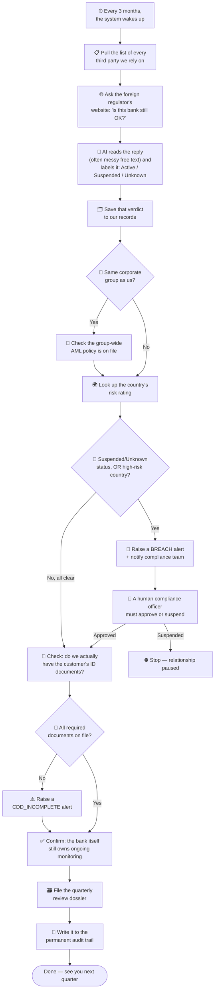

# UC10 — Third-Party CDD Reliance Oversight & Ongoing Monitoring Assurance
## A plain-language guide to the n8n workflow (no banking background needed)

---

## 1. What problem is this solving?

Banks are supposed to personally check the identity of every customer they take on — this check is called **CDD** (Customer Due Diligence). It's the "who are you, really, and is your money clean?" check.

Sometimes a bank doesn't do that check itself. Instead, it **trusts another financial institution** to have already done it. For example, a Pakistani bank might say: *"Gulf Trust Bank in the UAE already verified this corporate customer for us — we'll rely on their check instead of redoing it."*

SBP (State Bank of Pakistan) allows this — it's called **reliance on a third party** — but only under conditions:

1. The Pakistani bank is still **100% on the hook** if anything goes wrong. Relying on someone else never transfers away the responsibility.
2. The third party (Gulf Trust Bank) must still be a **properly regulated, currently-licensed** institution — not suspended, not shut down, not based in a blacklisted country.
3. The Pakistani bank must **actually have the customer's documents** on file, not just a verbal assurance.

**This workflow is the automated "quarterly health check" that makes sure all three conditions keep holding true** — because a third party that was fine two years ago might have since lost its license, moved into a sanctioned jurisdiction, or gone quiet.

Think of it like a landlord who sublets an apartment through a management company: the landlord (the bank) is still legally responsible for the building, so once a quarter they check that the management company (the third party) is still licensed and hasn't gone rogue — and they still keep a copy of every tenant's ID on file themselves, just in case.

---

## 2. The regulation behind it (SBP Regulation 3), in one sentence each

| Clause | Plain-English meaning |
|---|---|
| §2 | Even if a third party checked the customer, **the bank still owns the outcome**. |
| §3 | The bank must **still watch the account for suspicious activity** and file reports itself — outsourcing the ID check doesn't outsource the watching. |
| §4 | The bank must **actually collect and hold the customer's ID paperwork** from the third party, not just trust their word. |
| §5 | The bank must **verify the third party is a real, licensed, supervised institution** with its own proper CDD/record-keeping controls. |
| §6 | The bank must check the third party **isn't based in a high-risk country** (Regulation 14's blacklist). |
| §7 | If the third party is part of the **same corporate group**, extra group-policy paperwork is required. |

---

## 3. The story in one picture



That's the entire workflow. Every box above is one (or a few) automated steps in n8n. The only manual, human step is the "🙋" diamond — everything else runs by itself.

---

## 3b. The technical version of the same picture

The diagram above is deliberately non-technical. Here is the same workflow described as an actual **system architecture** — the real services, node types, and data stores involved, for whoever has to build, run, or debug this.

```mermaid
flowchart LR
    subgraph n8n["n8n Orchestration Layer"]
        T["Schedule Trigger\n(cron: 0 9 1 */3 *)"] --> PG1["Postgres\nSELECT reliance_arrangements"]
        PG1 --> HTTP1["HTTP Request\nGET mock-registry/status"]
        HTTP1 --> HTTP2["HTTP Request (POST)\nQuery Vector Store"]
        HTTP2 --> HTTP3["HTTP Request (POST)\nLLM classify-status"]
        HTTP3 --> SET1["Set\nnormalize -> active/suspended/unknown"]
        SET1 --> PG2["Postgres\nUPDATE reliance_arrangements"]
        PG2 --> IF1{"IF\nis_same_corporate_group"}
        IF1 -->|true| PG3["Postgres\nSELECT GROUP_AML_POLICY doc"]
        IF1 -->|false| PG4
        PG3 --> PG4["Postgres\nSELECT jurisdiction_list.risk_tier\n(SQL fallback: high_risk if missing)"]
        PG4 --> IF2{"IF\nstatus != active\nOR risk_tier = high_risk"}
        IF2 -->|true| PG5["Postgres INSERT alerts\n(RELIANCE_BREACH, high)"]
        IF2 -->|false| PG6
        PG5 --> SLK1["Slack sendMessage\n#cdd-reliance"]
        SLK1 --> IF3{"IF status = suspended"}
        IF3 -->|true| MAIL1["Email\nHead of Compliance"]
        IF3 -->|false| WAIT1
        MAIL1 --> WAIT1["Slack sendAndWait\nCompliance Approval"]
        WAIT1 --> IF4{"IF approved"}
        IF4 -->|false| STOP["Postgres INSERT audit_logs\n(SUSPENDED)"]
        IF4 -->|true| PG6["Postgres\nSELECT documents\n(CDD file check)"]
        PG6 --> AGG["Aggregate\ndocument_type -> array"]
        AGG --> IF5{"IF FORM_A, CNIC_COPY,\nKYC_SHEET all present"}
        IF5 -->|false| PG7["Postgres INSERT alerts\n(CDD_INCOMPLETE, medium)"]
        IF5 -->|true| SET2
        PG7 --> SET2["Set\nbank_retains_responsibility=true"]
        SET2 --> PG8["Postgres INSERT documents\n(RELIANCE_DOSSIER)"]
        PG8 --> PG9["Postgres INSERT audit_logs\n(RELIANCE_VERIFICATION_COMPLETED)"]
    end

    subgraph ext["External / Local Services"]
        REG["Mock Regulator\nRegistry API\n:5678"]
        RAG["RAG Retrieval Service\n(FastAPI + Chroma)\nsbp_rag_server.py\n:8000"]
        LLM["LLM Classifier\nMicroservice\n:8001"]
        VDB[("Chroma\nVector Store\nsbp_aml_cft_cpf_regulations")]
    end

    subgraph db["PostgreSQL — synthetic sandbox schema"]
        T1[(reliance_arrangements)]
        T2[(jurisdiction_list)]
        T3[(documents)]
        T4[(alerts)]
        T5[(audit_logs)]
    end

    HTTP1 -.calls.-> REG
    HTTP2 -.calls.-> RAG
    RAG -.reads.-> VDB
    HTTP3 -.calls.-> LLM
    PG1 -.reads.-> T1
    PG2 -.writes.-> T1
    PG3 -.reads.-> T3
    PG4 -.reads.-> T2
    PG5 -.writes.-> T4
    PG6 -.reads.-> T3
    PG7 -.writes.-> T4
    PG8 -.writes.-> T3
    PG9 -.writes.-> T5
    STOP -.writes.-> T5
```



**How to read this version:** the top box is everything that lives inside n8n (the orchestration — every node you'll see on the canvas after importing the JSON). The bottom-left box is the three small local services this workflow calls out to over plain HTTP — a mock registry, a retrieval service backed by Chroma, and a lightweight LLM classifier. The bottom-right box is the actual Postgres tables being read from or written to at each step, so anyone reviewing this can trace exactly where a given piece of data came from or ended up.

The RAG Retrieval Service box (`sbp_rag_server.py`, backed by the Chroma store built by `sbp_rag_ingest.py`) is the piece covered in detail in Section 10 below.

---

## 4. Walking through it step by step (with the two example third parties)

The synthetic test data has two example third parties on file:

| Third party | Country | What should happen |
|---|---|---|
| **Gulf Trust Bank** | UAE (normal risk) | Passes — quiet quarterly all-clear |
| **Offshore Credit Co** | "Country-X" (high-risk) | Fails — triggers a breach alert and a human review |

### Step-by-step for **Gulf Trust Bank** (the "good" path)

1. **Timer fires** on the 1st of the quarter.
2. **Pull the reliance list** from our database — Gulf Trust Bank shows up as one row.
3. **Ask the mock regulator API** "what's Gulf Trust Bank's status?" → it replies with a sentence like *"License is currently active with no sanctions."*
4. **Fetch the exact regulation wording** (Reg 3 §5) from a searchable reference library, so the next step doesn't have to guess what "properly regulated" means — it's grounded in the actual rule text.
5. **AI reads the sentence** and turns it into a clean label: `active`.
6. **Save that verdict** to the database.
7. **Is Gulf Trust Bank part of our own corporate group?** No → skip the group-policy check.
8. **Look up UAE's risk rating** → `normal`.
9. **Is this a breach?** Status is `active` AND country is `normal` → **No breach.** Skip the alert/human-approval branch entirely.
10. **Check our files**: do we actually hold this customer's `FORM_A`, `CNIC_COPY`, and `KYC_SHEET`? → Yes, all present.
11. **Confirm** the bank itself still owns ongoing monitoring (this is always logged, regardless of outcome — it's a standing fact, not a conditional one).
12. **File the quarterly dossier** and **write the audit-trail entry.** Done — quietly, with no human needed.

### Step-by-step for **Offshore Credit Co** (the "bad" path)

1–6. Same as above, except the registry reply mentions a **suspended license**, so the AI labels it `suspended`.
7. Not part of our group → skip.
8. **Country-X's risk rating** → `high_risk`.
9. **Is this a breach?** Status is `suspended` **and** country is `high_risk` → **Yes, breach.**
10. The system **inserts a high-severity alert**, **posts a message to the compliance team's chat channel**, and — because the status is specifically `suspended` — **emails the Head of Compliance** directly.
11. The workflow **pauses and waits** for a real person to click "Authorize Continuation" or "Suspend Relationship" in that chat message. Nothing else happens until a human decides.
    - If **suspended** → the workflow stops there, and the decision is logged.
    - If **authorized to continue** (e.g., there's a legitimate temporary reason) → the workflow keeps going.
12. **Check our files** for the required documents, same as before, and finish with the dossier + audit log.

---

## 5. Where does the data live? (in everyday terms)

Think of the database as a set of spreadsheets. This workflow reads from and writes to:

- **`reliance_arrangements`** — the master list of "banks we rely on," with their current status and country.
- **`jurisdiction_list`** — a lookup table of "which countries are considered risky."
- **`documents`** — proof that we hold the customer's paperwork (and, separately, proof the third party's group policy is on file).
- **`alerts`** — the list of open issues someone needs to look at.
- **`audit_logs`** — a permanent, tamper-evident diary of "what the system did and when," used if SBP ever inspects the bank.

Nothing here is a "real" bank record — it's a synthetic sandbox database used for testing the automation, per your setup.

---

## 6. Where AI is used — and, importantly, where it is *not*

This workflow uses AI/LLM in exactly **one place**: turning a messy, free-text regulator disclosure ("License is currently active with no sanctions...") into one of three clean labels — `active`, `suspended`, `unknown`. That's it. It never decides whether something is a breach, never decides whether to freeze anything, and never approves a relationship.

Every decision that actually matters — is this a breach, is the country high-risk, are the documents complete, does a human need to sign off — is a plain, deterministic **IF/rule check** against the database, exactly as SBP Regulation 3 states it. If the AI step ever fails or times out, the workflow doesn't guess "probably fine" — it defaults to `unknown`, which is treated the same as a red flag. That's a deliberate safety choice: **when in doubt, escalate to a human, never assume compliance.**

---

## 7. The one human decision point, explained

Compliance software should never let a robot "approve" a bank relationship on its own where a real due-diligence judgment call is involved. So the moment a breach condition is detected (suspended status or a high-risk country), the workflow:

1. Posts full context (which third party, what status, what country) into a Slack-style message.
2. **Stops and genuinely waits** — no time limit, no auto-continue — for a compliance officer to click a button.
3. Only resumes once that decision is recorded, and logs exactly who decided what.

This mirrors real bank practice: automation gathers the facts and flags the risk; a licensed human makes the judgment call and is accountable for it.

---

## 8. What's inside the workflow file, node by node

| # | Node name | Plain description |
|---|---|---|
| 1 | Quarterly Timer | Wakes the workflow up once every 3 months |
| 2 | Fetch Reliance Arrangements | Pulls the list of third parties we depend on |
| 3 | Query Registry API (mock) | Asks the (simulated) foreign regulator for a status update |
| 3b | Retrieve Reg 3 §5 (RAG) | Fetches the exact wording of the relevant SBP rule, so the AI step is grounded in real regulation text, not guesswork |
| 4 | AI Interpret Status | Reads the regulator's free-text reply and labels it active/suspended/unknown |
| 4b | Map Registry Status | Tidies that label into a clean record; defaults to "unknown" if step 3 or 4 failed |
| 5 | Update Reliance Status | Saves the verified status |
| 6 | IF Group Member? | Checks if the third party is part of our own corporate group |
| 7 | Verify Group Policy | If yes, confirms the group-wide AML policy paperwork exists |
| 8 | Fetch Jurisdiction Risk | Looks up the third party's country risk rating (defaults to "high risk" if the country isn't even in our list — a cautious fallback) |
| 9 | IF Breach Detected? | The core rule: not-active status OR high-risk country = breach |
| 10 | Insert Breach Alert | Logs a high-severity alert |
| 10b | Notify Slack | Posts the alert to the compliance team's channel |
| 10c/10d | IF Suspended → Email | If specifically "suspended," also emails the Head of Compliance directly |
| 11 | Compliance Approval Sign-Off | Pauses and waits for a real person's decision |
| 11b | IF Approved? | Routes based on that human decision |
| — | Reliance Suspended | End-state if the officer says "suspend" |
| 12 | Fetch Customer CDD Files | Pulls the list of documents we actually hold for this customer |
| 12b | Aggregate Document Types | Combines that list into one easy-to-check set |
| 13 | IF Documents Complete? | Checks the three required document types are all present |
| 14 | Insert CDD Alert | Logs a medium-severity alert if any are missing |
| 15 | Log Bank Responsibility | Records, every single time, that the bank itself still owns ongoing monitoring |
| 16 | Insert Reliance Dossier | Files the finished quarterly review record |
| 17 | Write Audit Log | Adds the permanent "what happened" entry to the audit trail |

---

## 10. The RAG code — grounding the AI step in the actual SBP document

Section 6 mentioned that before the AI ever classifies a registry status, it first retrieves the **real regulation clause text** so it isn't guessing what "properly regulated" means. Here is exactly how that retrieval piece is built, straight from the SBP AML/CFT/CPF Regulations PDF you provided.

### 10.1 What the code does

Two small scripts, run once to build the index and then continuously to serve lookups:

| Script | Role |
|---|---|
| `sbp_rag_ingest.py` | **One-time (or on-update) job.** Reads the PDF, cleans it, splits it into individual Regulation/§-clause chunks (e.g. "Regulation 3 §5"), embeds each chunk, and stores it in a local Chroma vector database. |
| `sbp_rag_server.py` | **Always-on service.** A tiny FastAPI app exposing `POST /api/vector-db/query` — the exact endpoint n8n's node 3b calls. Given a plain-English question, it returns the closest-matching clause(s). |

This is retrieval-only. It never drafts text and never makes a compliance decision — it just answers "which exact clause is this situation talking about?" so the downstream LLM step (and any human reviewer) is grounded in the real regulation, not a paraphrase.

### 10.2 How the chunking actually works (verified against your PDF)

The script locates every `REGULATION – N` heading, then splits each regulation's body further wherever it finds a numbered clause marker (`1)`, `2)`, `3)` ...). Annexure I and Annexure II are each kept as one whole chunk, since they're short reference tables rather than obligation clauses.

Running it against your uploaded PDF produces exactly this — including all **7 clauses of Regulation 3**, the regulation this use case is built on:

```
Reg 1  -> 13 clauses      Reg 6  -> 7 clauses      Reg 11 -> 9 clauses
Reg 2  -> 29 clauses      Reg 7  -> 1 clause        Reg 12 -> 7 clauses
Reg 3  -> 7 clauses  ✅   Reg 8  -> 6 clauses      Reg 13 -> 16 clauses
Reg 4  -> 14 clauses      Reg 9  -> 4 clauses      Reg 14 -> 1 clause
Reg 5  -> 1 clause        Reg 10 -> 6 clauses      Reg 15 -> 4 clauses
Annexure I  -> 1 chunk (2,989 characters)
Annexure II -> 1 chunk (9,986 characters)
```

Regulation 3, §1 through §7, matches precisely: §2 (ultimate responsibility), §3 (ongoing monitoring stays with the bank), §4 (obtain the documents), §5 (verify the third party is regulated), §6 (jurisdiction check), §7 (group policy) — the exact clauses cited throughout this use case.

### 10.3 `sbp_rag_ingest.py` — build the vector store

```python
"""
sbp_rag_ingest.py
------------------------------------------------------------------
Builds the local Chroma vector store that n8n's "3b. Retrieve Reg 3 §5
(RAG - Chroma)" node queries at http://localhost:8000/api/vector-db/query.

What it does, in order:
  1. Reads the SBP AML/CFT/CPF Regulations PDF straight off disk.
  2. Cleans repeated page headers/footers ("12 | Page", "AML/ CFT/ CPF
     Regulations") that pdfplumber leaves inline mid-sentence.
  3. Splits the text into REGULATION-level blocks (Regulation 1 .. 15),
     then splits each block again into individual numbered clauses
     (§1, §2, §3 ...) — this is the exact granularity the workflow
     cites (e.g. "Regulation 3 §5").
  4. Splits Annexure I and Annexure II into their own two chunks
     (document-checklist tables are short enough to embed whole).
  5. Embeds every chunk with a small local sentence-transformer model
     (no external API key needed — keeps this runnable in a sandbox).
  6. Upserts everything into a persistent local Chroma collection.

Run once (and again any time the PDF is updated):
    python sbp_rag_ingest.py --pdf /path/to/DOC-20260706-WA0009_.pdf

Dependencies:
    pip install pdfplumber chromadb sentence-transformers --break-system-packages
"""

import argparse
import re
from pathlib import Path

import pdfplumber
import chromadb
from sentence_transformers import SentenceTransformer

COLLECTION_NAME = "sbp_aml_cft_cpf_regulations"
DEFAULT_DB_PATH = "./chroma_sbp_db"
EMBEDDING_MODEL = "all-MiniLM-L6-v2"   # small, local, no API key required


def extract_raw_text(pdf_path: str) -> str:
    """Pull text out of every page and join it into one long string."""
    pages = []
    with pdfplumber.open(pdf_path) as pdf:
        for page in pdf.pages:
            pages.append(page.extract_text() or "")
    return "\n".join(pages)


def clean_page_furniture(text: str) -> str:
    """Strip the repeating page-number and running-header noise that
    pdfplumber otherwise leaves sitting in the middle of a clause."""
    text = re.sub(r'\d+\s*\|\s*P\s*a\s*g\s*e', ' ', text)
    text = re.sub(r'AML/\s*CFT/\s*CPF Regulations', ' ', text)
    text = re.sub(r'[ \t]+', ' ', text)
    return text


def chunk_regulations(text: str) -> list[dict]:
    """Split Part C into Regulation-level blocks, then clause-level
    chunks within each block. Returns a flat list of chunk records."""
    chunks = []

    reg_headers = list(re.finditer(r'REGULATION\s*[–—-]\s*(\d+)', text))
    # Regulation 15's block must stop at Annexure-I, not run into it.
    annexure_i_match = re.search(r'^Annexure[\s-]*I\s*\n', text, re.MULTILINE)
    hard_stop = annexure_i_match.start() if annexure_i_match else len(text)

    block_bounds = [m.start() for m in reg_headers] + [len(text)]

    for i, header in enumerate(reg_headers):
        reg_no = header.group(1)
        block_start = header.end()
        block_end = min(block_bounds[i + 1], hard_stop) if reg_no == "15" else block_bounds[i + 1]
        block = text[block_start:block_end]

        # Everything before the first "1) ..." clause is the regulation's title.
        first_clause = re.search(r'\n\s*1\)\s', "\n" + block)
        if first_clause:
            title = block[:first_clause.start()].strip().replace("\n", " ")
            body = block[first_clause.start():]
        else:
            title = block[:80].strip().replace("\n", " ")
            body = block

        clause_markers = list(re.finditer(r'\n\s*(\d{1,2})\)\s', "\n" + body))
        clause_bounds = [m.start() for m in clause_markers] + [len(body) + 1]

        if not clause_markers:
            chunks.append({
                "regulation_no": reg_no,
                "regulation_title": title,
                "clause_no": None,
                "citation": f"Regulation {reg_no}",
                "text": body.strip(),
            })
            continue

        for j, marker in enumerate(clause_markers):
            clause_no = marker.group(1)
            clause_text = ("\n" + body)[clause_bounds[j]:clause_bounds[j + 1]].strip()
            chunks.append({
                "regulation_no": reg_no,
                "regulation_title": title,
                "clause_no": clause_no,
                "citation": f"Regulation {reg_no} §{clause_no}",
                "text": f"{title} — Regulation {reg_no} §{clause_no}: {clause_text}",
            })

    return chunks


def chunk_annexures(text: str) -> list[dict]:
    """Annexure I and Annexure II are indexed as two whole-document
    chunks — they are short reference tables, not obligation clauses,
    so clause-level splitting isn't needed."""
    chunks = []
    ann_i = re.search(r'^Annexure[\s-]*I\s*\n', text, re.MULTILINE)
    ann_ii = re.search(r'^Annexure[\s-]*II\s*\n', text, re.MULTILINE)

    if ann_i and ann_ii:
        chunks.append({
            "regulation_no": "Annexure-I",
            "regulation_title": "List of Information Required for Customer Identity",
            "clause_no": None,
            "citation": "Annexure I",
            "text": text[ann_i.start():ann_ii.start()].strip(),
        })
        chunks.append({
            "regulation_no": "Annexure-II",
            "regulation_title": "Minimum Documents to be Obtained for Identification of Customer/Occasional Customer",
            "clause_no": None,
            "citation": "Annexure II",
            "text": text[ann_ii.start():].strip(),
        })
    return chunks


def build_vector_store(pdf_path: str, db_path: str = DEFAULT_DB_PATH) -> None:
    print(f"Reading PDF: {pdf_path}")
    raw_text = extract_raw_text(pdf_path)
    text = clean_page_furniture(raw_text)

    reg_chunks = chunk_regulations(text)
    annexure_chunks = chunk_annexures(text)
    all_chunks = reg_chunks + annexure_chunks
    print(f"Built {len(all_chunks)} chunks "
          f"({len(reg_chunks)} regulation clauses + {len(annexure_chunks)} annexures)")

    print(f"Loading embedding model: {EMBEDDING_MODEL}")
    model = SentenceTransformer(EMBEDDING_MODEL)

    texts = [c["text"] for c in all_chunks]
    embeddings = model.encode(texts, show_progress_bar=True, normalize_embeddings=True).tolist()

    client = chromadb.PersistentClient(path=db_path)
    try:
        client.delete_collection(COLLECTION_NAME)
    except Exception:
        pass
    collection = client.create_collection(
        name=COLLECTION_NAME,
        metadata={"description": "SBP AML/CFT/CPF Regulations, chunked by Regulation/section"},
    )

    ids = [f"{c['regulation_no']}-{c['clause_no'] or 'full'}-{i}" for i, c in enumerate(all_chunks)]
    metadatas = [
        {
            "regulation_no": str(c["regulation_no"]),
            "regulation_title": c["regulation_title"],
            "clause_no": str(c["clause_no"]) if c["clause_no"] else "",
            "citation": c["citation"],
        }
        for c in all_chunks
    ]

    collection.add(ids=ids, embeddings=embeddings, documents=texts, metadatas=metadatas)
    print(f"Stored {collection.count()} chunks in Chroma collection "
          f"'{COLLECTION_NAME}' at '{db_path}'")


if __name__ == "__main__":
    parser = argparse.ArgumentParser(description="Ingest the SBP AML/CFT/CPF PDF into Chroma.")
    parser.add_argument("--pdf", required=True, help="Path to the SBP Regulations PDF")
    parser.add_argument("--db-path", default=DEFAULT_DB_PATH, help="Chroma persistent storage folder")
    args = parser.parse_args()

    if not Path(args.pdf).exists():
        raise SystemExit(f"PDF not found: {args.pdf}")

    build_vector_store(args.pdf, args.db_path)
```

### 10.4 `sbp_rag_server.py` — serve retrievals to n8n

```python
"""
sbp_rag_server.py
------------------------------------------------------------------
The tiny local service that n8n's "3b. Retrieve Reg 3 §5 (RAG - Chroma)"
node calls over HTTP. Retrieval ONLY — no generation, no compliance
decisions — it returns the most relevant regulation clause(s) for a
natural-language query, grounded in the vector store built above.

Run:
    pip install fastapi uvicorn chromadb sentence-transformers --break-system-packages
    python sbp_rag_server.py
    (serves on http://localhost:8000)

Matches the n8n node's call:
    POST http://localhost:8000/api/vector-db/query
    body: {"query": "third party regulated supervised CDD record keeping"}
"""

from typing import Optional

import chromadb
from fastapi import FastAPI
from pydantic import BaseModel
from sentence_transformers import SentenceTransformer

COLLECTION_NAME = "sbp_aml_cft_cpf_regulations"
DB_PATH = "./chroma_sbp_db"
EMBEDDING_MODEL = "all-MiniLM-L6-v2"

app = FastAPI(title="SBP AML/CFT/CPF Regulation Retriever")

_model = SentenceTransformer(EMBEDDING_MODEL)
_client = chromadb.PersistentClient(path=DB_PATH)
_collection = _client.get_collection(COLLECTION_NAME)


class QueryRequest(BaseModel):
    query: str
    top_k: int = 3
    regulation_no: Optional[str] = None   # e.g. "3" to search only Regulation 3


class QueryResponse(BaseModel):
    clause: str
    citation: str
    matches: list


@app.post("/api/vector-db/query", response_model=QueryResponse)
def query_regulations(req: QueryRequest):
    query_embedding = _model.encode([req.query], normalize_embeddings=True).tolist()
    where_filter = {"regulation_no": req.regulation_no} if req.regulation_no else None

    results = _collection.query(
        query_embeddings=query_embedding,
        n_results=req.top_k,
        where=where_filter,
    )

    matches = [
        {
            "citation": meta["citation"],
            "text": doc,
            "similarity_score": round(1 - dist, 4),
        }
        for doc, meta, dist in zip(results["documents"][0], results["metadatas"][0], results["distances"][0])
    ]

    top = matches[0] if matches else {"citation": "N/A", "text": "No matching clause found."}

    return QueryResponse(
        clause=f"{top['citation']}: {top['text']}",
        citation=top["citation"],
        matches=matches,
    )


@app.get("/health")
def health():
    return {"status": "ok", "collection_size": _collection.count()}


if __name__ == "__main__":
    import uvicorn
    uvicorn.run(app, host="0.0.0.0", port=8000)
```

### 10.5 Setting it up

```bash
pip install pdfplumber chromadb sentence-transformers fastapi uvicorn --break-system-packages

# Build the index once (re-run any time the SBP PDF is updated)
python sbp_rag_ingest.py --pdf DOC-20260706-WA0009_.pdf

# Start the retrieval service the n8n workflow talks to
python sbp_rag_server.py
```

Node 3b in the n8n workflow already points at `http://localhost:8000/api/vector-db/query` — once this service is running, that node stops being a mock and starts returning real, grounded clause text from your actual SBP document.

---

## 11. How to try it yourself

1. Import `ThirdParty_CDD_Reliance_Oversight.json` into your n8n instance (**Workflows → Import from File**).
2. Point the Postgres credential at your synthetic sandbox database (the shared schema you already set up covers `reliance_arrangements`, `jurisdiction_list`, `documents`, `alerts`, and `audit_logs`).
3. Load the two synthetic test rows (Gulf Trust Bank / UAE and Offshore Credit Co / Country-X — see the SQL insert statements you already have from the use-case extraction).
4. Either wait for the quarterly cron, or click **"Execute Workflow"** manually to run it immediately for testing.
5. Point nodes 3, 3b, and 4 at simple mock endpoints (even a basic local server that returns fixed JSON is enough at this stage) — you don't need a real regulator API or a real LLM key to test the branching logic end-to-end.
6. Watch the run: Gulf Trust Bank should sail straight through; Offshore Credit Co should stop and wait for your approval click.

That's the whole loop — nothing here needs a production LLM subscription or a live regulator feed to test; it's designed to run entirely against your synthetic sandbox.
