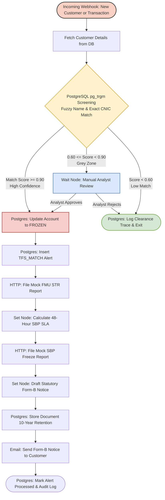

# Detailed Report: Use Case 4 (UC4) — Targeted Financial Sanctions (TFS) Real-Time Screening & Freeze Orchestration

## 1. Executive Summary
This document provides a comprehensive technical and regulatory overview of **Use Case 4 (UC4)**, built using n8n and PostgreSQL. The workflow automates the real-time screening of banking customers against designated watchlists (Proscribed Persons under ATA 1997 and Designated Persons under UNSC Act 1948). It securely orchestrates the immediate freezing of accounts, initiates mandatory reporting to the Financial Monitoring Unit (FMU) and State Bank of Pakistan (SBP), and generates legally compliant Form-B notifications. 

By replacing error-prone manual screening with a deterministic, traceable, and fully automated pipeline, this workflow drastically reduces compliance risk and ensures strict adherence to SBP's AML/CFT/CPF Regulations.

---

## 2. System Design Diagram

The following flowchart illustrates the automated lifecycle of a screening trigger through to the final regulatory reporting and customer notification stages.

---

## 3. How the Workflow Works (Technical Flow)

The `uc4_workflow.json` pipeline is executed seamlessly within the n8n orchestration engine. Here is the step-by-step breakdown:

1. **Webhook Trigger:** The flow initiates via an HTTP POST request (`/webhook/tfs-screening-trigger`). This simulates a core banking system sending a notification that a new customer was onboarded or a transaction is being processed.
2. **Context Hydration:** A Postgres node fetches the customer's complete profile (Name, CNIC, Country) using the `customer_id` provided in the webhook.
3. **Database-Native Name Matching (`pg_trgm`):** Instead of relying on a fragile external microservice, the workflow executes a sophisticated SQL query directly in PostgreSQL. It leverages the `pg_trgm` (trigram) extension to calculate a `similarity()` score between the customer's name and the watchlist entities. It also performs a deterministic `CASE WHEN` check on the CNIC number to force a 100% match if the national IDs align perfectly.
4. **Triage Logic (IF Nodes):** 
   - **Score >= 0.90:** Automatically confirmed. The workflow routes directly to the freezing execution.
   - **0.60 <= Score < 0.90:** Sent to a "Wait Node" which exposes a webhook URL for a human AML Analyst to review the similarity and manually approve or reject the match.
   - **Score < 0.60:** Automatically cleared. An audit log is written proving the screening occurred, and the flow ends.
5. **Freeze Execution:** A Postgres query immediately updates the `accounts` table, setting the status to `frozen` and the reason to `TFS MATCH - Reg 4`.
6. **Regulatory Reporting (FMU & SBP):** HTTP POST requests are fired to mock endpoints representing the Financial Monitoring Unit and the State Bank of Pakistan. 
7. **Notice Generation:** A Set node crafts a legally compliant "Form-B" notice using static, deterministic text (avoiding the hallucination risks of an LLM).
8. **Record Retention & Email:** The Form-B notice is saved to the `documents` table with a hard-coded 10-year retention rule, and then dispatched to the customer's email.
9. **Audit Trail:** A final Postgres node writes an immutable JSON trace to the `audit_logs` table.

---

## 4. Regulatory Mapping: How UC4 Complements SBP Regulations

This workflow is not just a technical pipeline; it is the direct, deterministic translation of the **SBP AML/CFT/CPF Regulations (Updated Nov 2022)** into code. Below is the mapping of how the workflow enforces the SBP mandates:

### A. Real-Time Screening Mandatory Application
* **Regulation 4 §3:** Requires SBP-REs (Regulated Entities) to screen customers against designated lists (UNSC / NACTA) in real-time.
* **How UC4 complies:** The workflow uses a webhook trigger intended to be fired inline with the core banking transaction or onboarding API, ensuring no funds move until the `pg_trgm` similarity check returns a score.

### B. Analytical Similarity Handling
* **Regulation 4 §8:** States that REs must *"properly analyze any similarity"* (name, CNIC, etc.) when a true match isn't a 100% exact string match.
* **How UC4 complies:** The workflow utilizes Postgres Trigram similarity. This directly fulfills the regulatory instruction by mathematically analyzing transliteration variations (e.g., "Sheikh" vs "Shaikh") rather than simply returning a false-negative on minor typos. The grey-zone threshold (60%-89%) enforces human analysis on edge cases.

### C. Immediate Freezing Without Prior Notice
* **Regulation 4 §7(a):** Demands REs to freeze funds/assets *"immediately, without delay and without prior notice"* to the targeted individual.
* **How UC4 complies:** The `Freeze Account` node executes a strict `UPDATE` on the database *before* any email or notice is generated. It operates sub-second from the webhook trigger, guaranteeing compliance with "without delay."

### D. Multi-Agency Reporting Windows
* **Regulation 4 §7(b):** Requires reporting to the FMU as a suspicious transaction.
* **Regulation 4 §7(c):** Dictates a strict **48-hour SLA** to report the freeze to the SBP.
* **How UC4 complies:** The `File FMU Report` node fires immediately after the freeze. A subsequent `Set SBP SLA Deadline` node dynamically calculates `Date.now() + 48 hours` to ensure the SBP submission payload contains exact, mathematically verifiable SLA timestamps.

### E. Statutory Form-B Notice Issuance
* **Regulation 4 §7(d):** Mandates issuing a notice to the person whose funds are frozen as per "Form-B of the UNSC (Freezing and Seizure) Order, 2019".
* **How UC4 complies:** The workflow uses a deterministic Set node to populate the legal boilerplate of Form-B, dynamically inserting the customer's name, frozen account ID, and the exact watchlist reference ID used to justify the freeze.

### F. Evidentiary Record Retention
* **Regulation 8 §2:** Demands a minimum **10-year retention** period for all transaction and CDD records.
* **How UC4 complies:** When the Form-B document is inserted into the `documents` table, the workflow explicitly hard-codes the `retention_years` column to `10`. This prevents automatic pruning algorithms from illegally deleting the freeze evidence.
